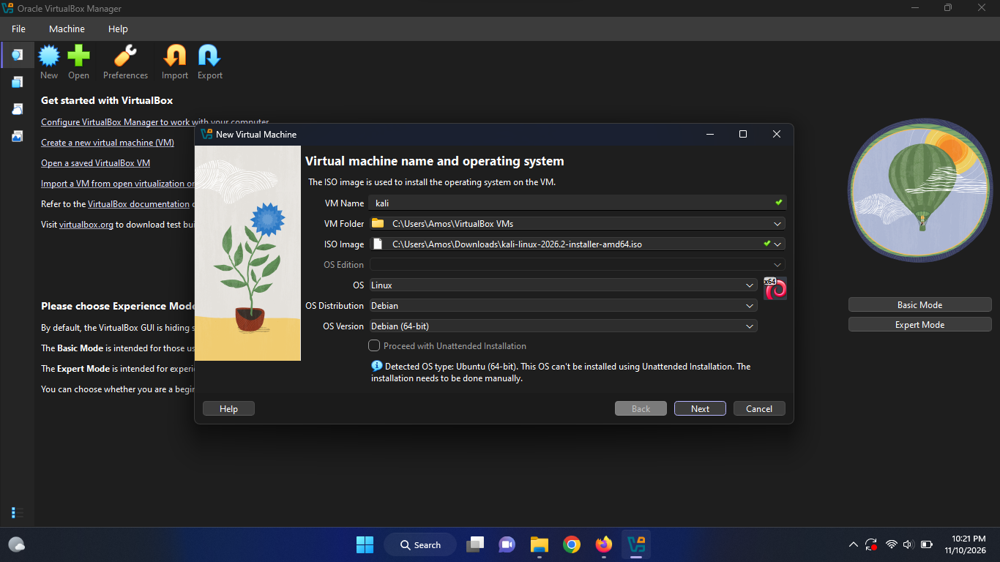
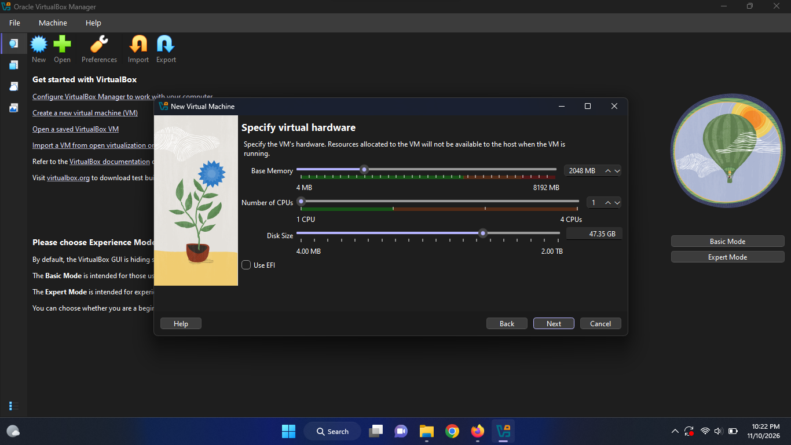
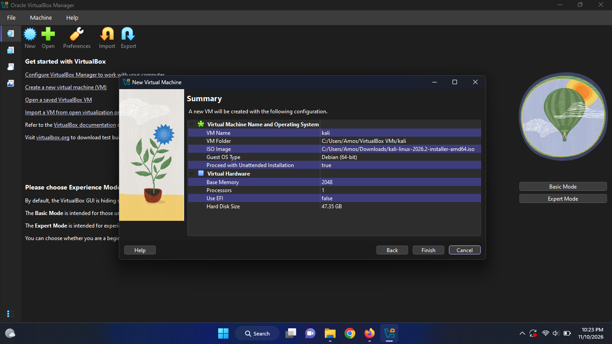
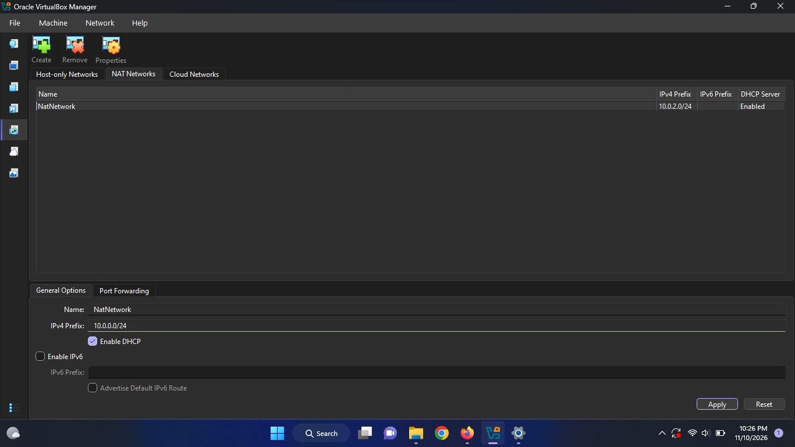
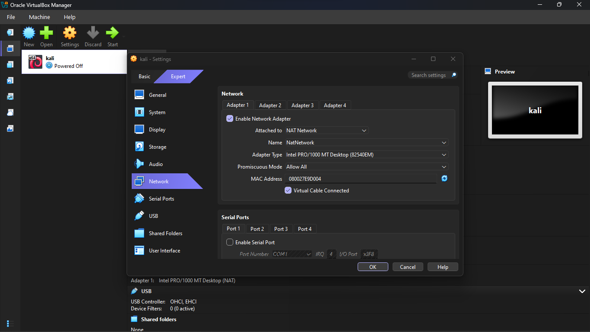
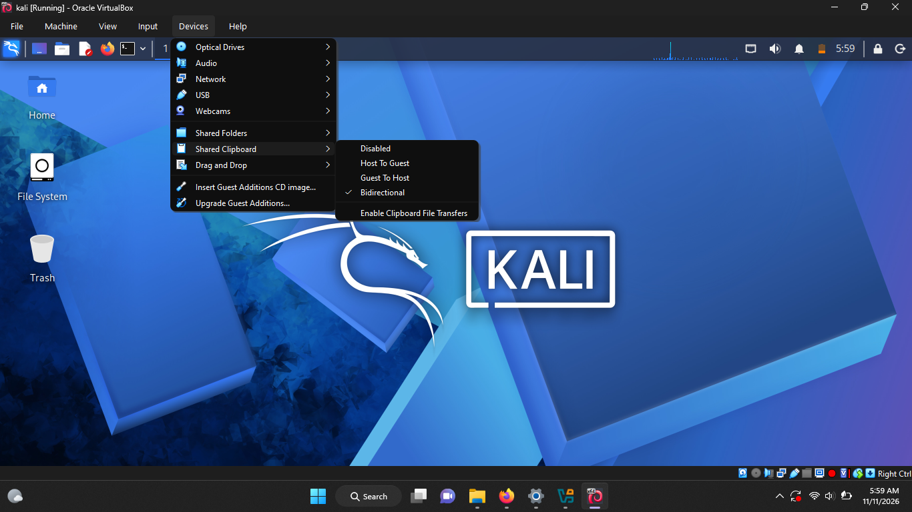
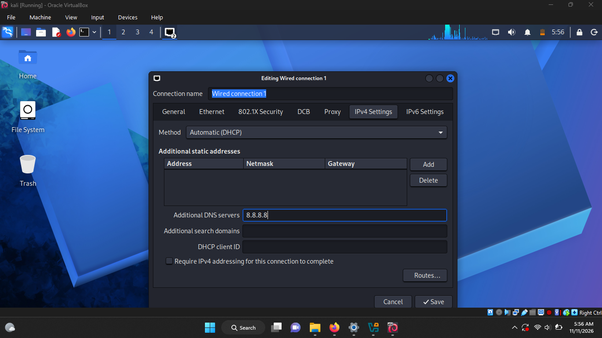
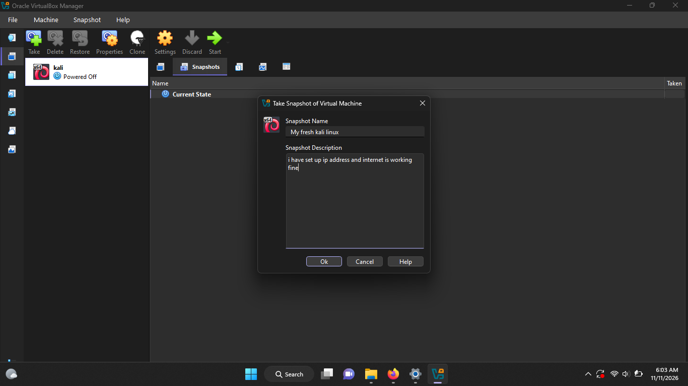

# Cybersecurity Virtual Lab Setup and Configuration

**Project:** Virtual Cybersecurity Lab  
**Focus:** Cybersecurity and Network Security  
**Host Environment:** Windows  
**Virtual Machine:** Kali Linux  
**Virtualization Software:** Oracle VirtualBox  
**Author:** John Muturi

---

## 1. Introduction

This project demonstrates the creation of a virtual cybersecurity laboratory using Oracle VirtualBox and Kali Linux.

The lab provides a separate environment where cybersecurity concepts, networking configurations, and practical security exercises can be explored without directly affecting the host operating system.

The setup includes virtual machine creation, resource allocation, network configuration, DNS testing, clipboard integration, and snapshot creation.

## 2. Project Goals

The main goals of this project were to:

- Install and configure Kali Linux within Oracle VirtualBox.
- Allocate and manage virtual machine resources.
- Establish network communication through NAT Network.
- Set up clipboard functionality between the host and guest systems.
- Configure and test DNS functionality.
- Confirm successful internet connectivity.
- Save a virtual machine snapshot for future restoration.

## 3. Lab Environment Architecture

The laboratory uses a Windows computer as the host system, with Oracle VirtualBox providing the virtualization layer. Kali Linux runs as the guest operating system.

**Network structure:**

```text
Windows Host
     |
     v
Oracle VirtualBox
     |
     v
  Kali Linux
     |
     v
  NAT Network
     |
     v
   Internet
```

## 4. System Configuration

| Component | Setup |
|---|---|
| Host Operating System | Windows |
| Virtualization Platform | Oracle VirtualBox |
| Guest Operating System | Kali Linux |
| Network Configuration | NAT Network |
| DNS Configuration | Configured and tested |
| VM Snapshot | Saved |
| Shared Clipboard | Enabled |

## 5. Implementation Process

### Step 1: Creating the Kali Linux Virtual Machine

Set up a new virtual machine in Oracle VirtualBox and prepared it to run the Kali Linux operating system.



### Step 2: Storage Allocation

Configured the virtual machine's storage settings to provide sufficient space for the operating system and its associated files.



### Step 3: Reviewing VM Settings

Checked the allocated resources and general configuration to ensure the virtual machine was ready for installation and operation.



### Step 4: Configuring the Network Adapter

Adjusted the virtual machine's network adapter settings to support communication through the NAT Network mode.



### Step 5: Setting Up the NAT Network

Created and configured the NAT Network within VirtualBox to allow the Kali Linux guest system to access external networks.



### Step 6: Enabling Clipboard Integration

Activated clipboard sharing to make copying and transferring text between Windows and Kali Linux easier.



## 6. DNS Configuration and Network Testing

Configured DNS settings and performed connectivity checks to confirm that the virtual machine could successfully translate domain names into IP addresses.

This helped verify that the guest operating system could communicate with external internet resources.



## 7. Virtual Machine Snapshot Management

Saved a snapshot of the configured Kali Linux virtual machine.

The snapshot acts as a recovery point, allowing the environment to be returned to its previous configuration if subsequent testing or modifications cause unexpected changes.



## 8. Challenges and Configuration Adjustments

During the setup, attention was given to virtual machine settings, network connectivity, storage allocation, and communication between the host and guest operating systems.

The configurations were tested to establish that the virtual environment was functioning as expected.

## 9. Skills and Knowledge Acquired

Working on this project provided practical exposure to:

- Virtual machine creation and administration.
- Virtual storage configuration.
- Virtualization concepts using Oracle VirtualBox.
- NAT Network configuration and connectivity.
- DNS operations and domain name resolution.
- Host and guest operating system integration.
- Snapshot creation and recovery procedures.
- Preparing isolated environments for cybersecurity experiments.

## 10. Security Considerations

The virtual laboratory is designed for learning, experimentation, and authorized cybersecurity activities.

Any security assessments or testing carried out using this environment should be limited to systems for which appropriate authorization has been obtained.

## 11. Technologies and Tools Used

- Windows Operating System
- Kali Linux
- Oracle VirtualBox
- NAT Network
- DNS
- Linux Command-Line Interface

## 12. Project Credits

**Author:** John Muturi

**Specialization:** Cybersecurity and Network Security

**GitHub:** https://github.com/youngcoderplus

---

*This project represents part of my hands-on journey in developing practical cybersecurity and networking skills.*